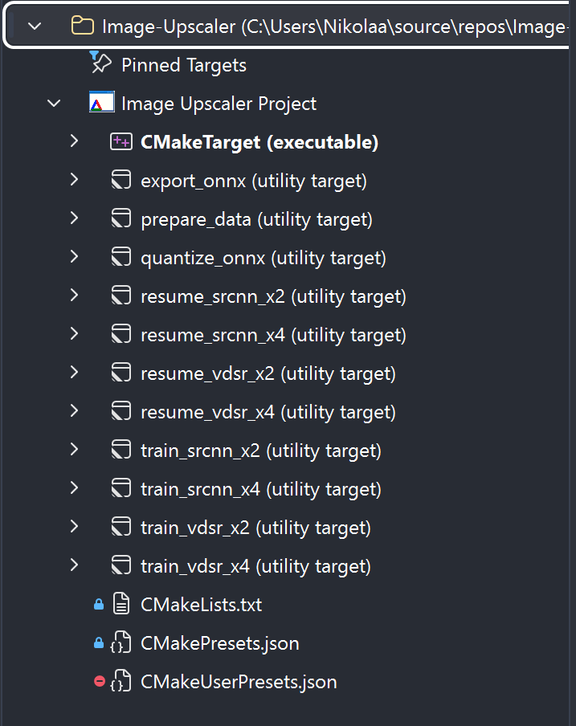
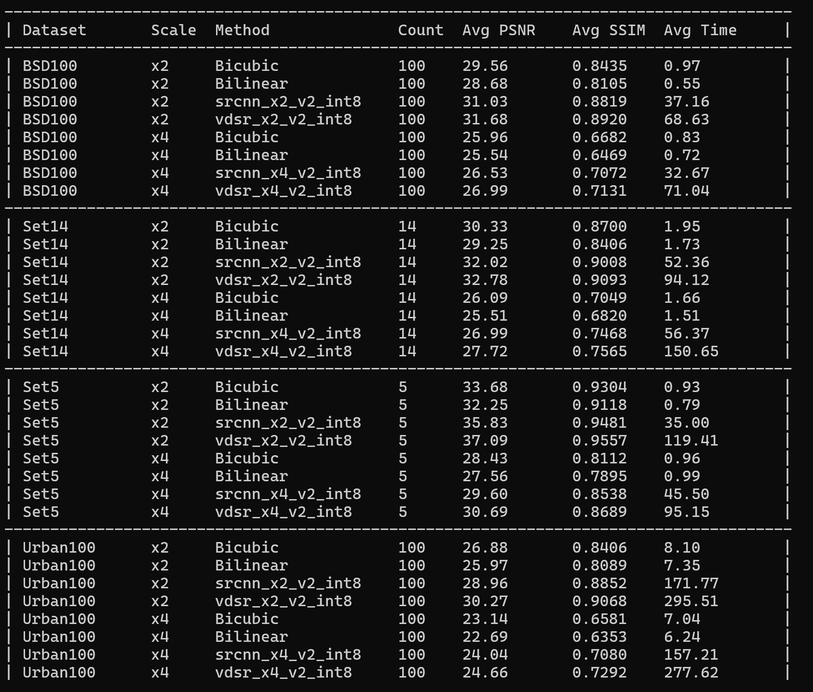

# Image Upscaler

A C++ image super-resolution playground that compares classical interpolation methods (**Bilinear**, **Bicubic**) against **learned CNN models** - the original three-layer **SRCNN** and a deeper **VDSR-style residual network** — trained in Python/PyTorch, exported to ONNX, and run in C++ via ONNX Runtime.

The project measures upscaling quality using **PSNR** and **SSIM**, and reports per-image and per-method timing so the different approaches can be compared side by side.

## Problem Statement

Enlarging a photo by classical scaling introduces pixels that don't exist in the source image. Naively stretching the image loses sharpness and detail, producing a blurry or blocky result. The goal of this project is to fill in those missing pixels using interpolation techniques and trained neural network.
Two families of approaches are compared:

- **Classical interpolation** - deterministic, per-pixel weighted averaging of neighboring pixels (**Bilinear**, **Bicubic**).
- **Learned reconstruction** - **Convolutional Neural Networks** (SRCNN, VDSR-style) trained to map low-resolution patches to high-resolution ones.

Both color (RGB) and grayscale images are supported, since a pixel is represented either as a `(R, G, B)` triple or a single intensity value.

## Overview

- **Classical interpolation** (`Bilinear`, `Bicubic`) is implemented from scratch in C++.
- **CNN models** (SRCNN and a VDSR-style net, see `CNN/models.py`) are trained in Python using PyTorch, exported to ONNX, and can be hot swapped simply by dropping new `.onnx` files into the models folder - every model found is automatically benchmarked.
- Image I/O is handled with [`stb_image`](Image%20Upscaler/includes/stb_image.h) / [`stb_image_write`](Image%20Upscaler/includes/stb_image_write.h).
- Inference uses **ONNX Runtime**, and channel conversion/resizing uses **OpenCV**.
- Both dependencies (OpenCV and ONNX Runtime) are fetched automatically by CMake — no manual installation required.

## Technologies

- **Languages:** C++, Python
- **C++ libraries:** STL, `stb_image.h`, `stb_image_write.h`, OpenCV 4.12, ONNX Runtime 1.31, OpenMP
- **Python libraries:** PyTorch, NumPy, OpenCV, Pillow, ONNX, ONNX Runtime
- **Compiler:** Visual C++ 2022, CMake ≥ 3.25
- **Interpreter:** Python 3.14 (PyTorch 2.13)

## Project Structure

```
Image Upscaler/
├── Image Upscaler.cpp        # Entry point: runs all methods and prints a results summary
├── core/
│   ├── Image.h / .cpp        # Simple RGB image container (load/save via stb_image)
│   └── Scaler.h / .cpp       # Separable resampling driven by an IInterpolator kernel (+ per-pixel reference)
├── interpolation/
│   ├── IInterpolator.h       # Interpolator interface
│   ├── Bilinear.h / .cpp     # Bilinear interpolation
│   └── Bicubic.h / .cpp      # Bicubic interpolation (Catmull-Rom kernel, a = -0.5)
├── metrics/
│   └── Metrics.h / .cpp      # PSNR and SSIM calculation
├── srcnn/
│   └── SRCNNUpscaler.h / .cpp# Loads a .onnx SRCNN model and runs inference via ONNX Runtime
└── includes/                 # stb_image / stb_image_write (public domain)

CNN/
├── models.py                  # Architectures: SRCNN (9-5-5) and VDSR-style residual net, picked by name
├── prepare_data.py            # Downloads T91/BSD200 (train) and Set5/Set14/BSD100/Urban100 (test), builds HR/LR PNGs
├── SRDataset.py               # Patch-based training dataset (augmentation + downscale/upscale pairs)
├── train_cnn.py               # Training loop (--arch srcnn|vdsr), saves the best checkpoint to models/pth/
└── export_onnx.py             # Exports trained checkpoints to models/onnx/<arch>_x<scale>_vN.onnx (--int8: quantized copy)

CMakeLists.txt                 # Top-level project, defines the prepare_data / train_* / export_onnx targets
Image Upscaler/CMakeLists.txt  # Builds the C++ executable, fetches OpenCV + ONNX Runtime
```

## Requirements

- **Visual Studio 2022** with the "Desktop development with C++" workload and CMake support
- **Python 3** (required for the `prepare_data`, `train_*` and `export_onnx` CMake targets — PyTorch, OpenCV-Python, Pillow, ONNX, and ONNX Runtime must be installed in that environment; pin it with `Python3_EXECUTABLE` in a `CMakeUserPresets.json` if CMake picks the wrong interpreter)
- Internet access on first configure (CMake `FetchContent` downloads prebuilt OpenCV and ONNX Runtime)

## Building & Running

This project is designed to be opened directly in **Visual Studio** as a CMake project (`File → Open → CMake...`), which will pick up `CMakePresets.json`.

1. Open the folder in Visual Studio and let it configure the CMake cache (this fetches OpenCV and ONNX Runtime on first run).
2. In the **CMake Targets View**, you'll see the project laid out as:
   - `CMakeTarget` — the C++ executable (the upscaler/benchmark itself)
   - `prepare_data` — downloads and prepares the training and benchmark datasets (`CNN/prepare_data.py`)
   - `train_<arch>_x<scale>` (`train_srcnn_x2`, `train_srcnn_x4`, `train_vdsr_x2`, `train_vdsr_x4`) — trains a model of that architecture for that scale factor from scratch
   - `resume_<arch>_x<scale>` — continues that training from where it stopped, with a fresh time budget
   - `export_onnx` — exports every already-trained checkpoint in `models/pth/` to ONNX
   - `quantize_onnx` — writes an int8 copy (`<name>_int8.onnx`) of every float model in `models/onnx/`

   

3. **Prepare the datasets:** Right-click `prepare_data` → **Build** (or run `python -I CNN/prepare_data.py`). This is needed once; it skips anything already present.
4. **(Optional) Train a model:** Right-click e.g. `train_vdsr_x2` → **Build**. This runs `CNN/train_cnn.py`, which trains the chosen network for that scale factor for a fixed time budget, saves the best checkpoint to `models/pth/best_<arch>_x<scale>.pth`, then automatically exports it to `models/onnx/<arch>_x<scale>_vN.onnx`. A model is only ever benchmarked at the scale it was trained for. From a terminal, the script takes more options:

   ```
   python CNN/train_cnn.py --arch srcnn --minutes 60 --scale 2 --batch-size 64 --lr 1e-4
   ```
5. **Run the benchmark:** Set `CMakeTarget` as the startup item and run it. It will:
   - Load every test set found in `data/test/` (one folder per set)
   - Upscale each `LR_x2` / `LR_x4` image using Bilinear, Bicubic, and every `.onnx` model found in `models/onnx/` whose name carries that scale (`<arch>_x<scale>_vN.onnx`)
   - Compute PSNR/SSIM against the `HR` images, write every per-image result to `results/results.csv` and print an averages table grouped by dataset, scale and method
   - Save all upscaled images to `results/<Set>/<Method>/x<scale>/`

   To run only some test sets, pass their names as arguments, e.g. `CMakeTarget.exe Set5 Set14` (in Visual Studio: project properties → Debugging → Command Arguments).

### Expected data layout

Everything below `data/test/`, `data/train/` and `data/_downloads/` is generated by `CNN/prepare_data.py` and ignored by git:

```
data/
├── train/HR/            # 291 training images: T91 + BSD200 (generated)
└── test/                # One folder per benchmark set (generated)
    └── <Set>/           # Set5, Set14, BSD100, Urban100
        ├── HR/          # Ground truth, mod-cropped to a multiple of 4, PNG
        ├── LR_x2/       # HR bicubic-downscaled by 2, PNG, same file names as HR/
        └── LR_x4/       # HR bicubic-downscaled by 4, PNG, same file names as HR/
models/
├── pth/                 # Checkpoints: best_<arch>_x<scale>.pth (exported) and last_<arch>_x<scale>.pth (resumable)
└── onnx/                # Benchmarked models, <arch>_x<scale>_vN.onnx and/or their int8 copies <arch>_x<scale>_vN_int8.onnx
                         # (shipped: srcnn_x2_v2_int8, srcnn_x4_v2_int8, vdsr_x2_v2_int8, vdsr_x4_v2_int8)
```

LR and HR files share the same name, so the benchmark pairs them directly. Any extra folder under `data/test/` with this layout is picked up automatically.

## Interpolation Methods

### Bilinear interpolation

Bilinear interpolation extends 1D linear interpolation to two dimensions.Llinear interpolation is applied along the x-axis first (giving two intermediate values `R1` and `R2`). Second linear interpolation is applied along the y-axis between those two values to get the final pixel `P`:

```
R1 = f(x, y1) = ((x2 - x) / (x2 - x1)) * f(Q11) + ((x - x1) / (x2 - x1)) * f(Q21)
R2 = f(x, y2) = ((x2 - x) / (x2 - x1)) * f(Q12) + ((x - x1) / (x2 - x1)) * f(Q22)
P  = f(x, y)  = ((y2 - y) / (y2 - y1)) * R1     + ((y - y1) / (y2 - y1)) * R2
```

This uses the 4 nearest neighboring pixels (`Q11`, `Q21`, `Q12`, `Q22`) around the target point.

Both interpolators are driven by the same resampling code (`core/Scaler.cpp`), which uses **pixel-centre alignment**: destination pixel `x` samples the source at `(x + 0.5) · ratio - 0.5`, the same convention as OpenCV, Pillow and MATLAB. Sanity check on Set5: our bicubic gives 33.68 dB at 2x and 28.43 dB at 4x, against 33.66 / 28.42 dB reported in the literature.

Each interpolator exposes its 1-D kernel (`radius()`, `weight(t)`) and its direct 2-D per-pixel formula (`interpolate(x, y)`). `Scaler::upscalePerPixel` evaluates the per-pixel formula for every output pixel — the textbook algorithm, kept as the reference. `Scaler::upscale`, used by the benchmark, computes the same thing **separably**: the kernel weights and source indices are precomputed once per destination column and row, a horizontal pass resamples every source row to the target width, and a vertical pass resamples the result to the target height, with rows processed in parallel (OpenMP). The output is identical to the per-pixel version (bilinear bit-exact; bicubic differs by ±1 in ~4 pixels per million from float vs. double accumulation) at a fraction of the cost: 16 kernel evaluations and 16 multiply-adds per pixel become 0 and ~6.

### Bicubic interpolation

Bicubic interpolation uses a 4×4 neighborhood (16 pixels) instead of 4, trading extra computation time for higher precision and sharper results:

```
I(x, y) = Σ(i=-1..2) Σ(j=-1..2)  I_orig(x_i, y_j) · w(x - x_i) · w(y - y_j)
```

where `w(x)` is the cubic convolution kernel:

```
w(x) = (a + 2)|x|³ - (a + 3)|x|² + 1        if |x| ≤ 1
w(x) = a|x|³ - 5a|x|² + 8a|x| - 4a          if 1 < |x| < 2
w(x) = 0                                     otherwise
```

`a` is typically `-0.5` (Catmull-Rom spline).

### Learned models (CNN)

Convolutional Neural Networks trained to learn the mapping from a low-resolution image to its high-resolution counterpart. Two architectures are available in `CNN/models.py` and selected by name (`--arch`):

| Name | Architecture | Params | Reference |
|---|---|---|---|
| `srcnn` | 3 conv layers, 9×9 → 5×5 → 5×5 kernels, 64 and 32 feature maps, no skip connection | ~57k | Dong et al., *Image Super-Resolution Using Deep Convolutional Networks*, 2014 |
| `vdsr` | 8 conv layers, 3×3 kernels, 64 feature maps, **residual learning** (the net predicts the correction added to the bicubic input). A shallower variant of the 20-layer original. | ~223k | Kim et al., *Accurate Image Super-Resolution Using Very Deep Convolutional Networks*, 2016 |

Common to both:

- Input: a single-channel (luminance) patch that has already been enlarged to the target size with bicubic interpolation; output: the reconstructed patch of the same size.
- Trained in **PyTorch** with **MSE loss** and the **Adam** optimizer. SRCNN uses a 10× smaller learning rate for its reconstruction layer, as in the paper.
- One model is trained **per scale factor**; the degradation it learns to undo depends on the factor, and a 2x model evaluated at 4x is no better than bicubic.
- Checkpoints (`models/pth/best_<arch>_x<scale>.pth`) store the architecture name, configuration and scale alongside the weights, so `export_onnx.py` can rebuild any model without extra arguments. A second file, `last_<arch>_x<scale>.pth`, is written every epoch with the optimizer and scheduler state so that training can be **resumed** (`--resume` or the `resume_*` targets): the epoch counter, learning-rate schedule and best validation loss continue from where they stopped, and the train/validation split is fixed by `--seed` so no validation patch is ever trained on.
- After training, the model is evaluated on images that were **not** part of the training set, to check that it generalizes rather than memorizes.
- **Inference on new images happens in C++ via ONNX Runtime**, after exporting the trained checkpoint to `.onnx`.
- **int8 quantization (optional):** `python CNN/export_onnx.py --int8` writes a statically quantized copy of each model (uint8 activations, per-channel int8 weights, calibrated on 20 training images degraded like the benchmark inputs). The quantized file sits next to the float one and is benchmarked like any other model. Measured on a VDSR 2x model: about 3.4× faster CPU inference for -0.01 to -0.02 dB PSNR and -0.0001 SSIM on Set5, Set14 and BSD100. The repository ships only the int8 copies of the four trained models (`models/onnx/*_int8.onnx`); the float ONNX files can be regenerated from the checkpoints in `models/pth/` with the `export_onnx` target.

## Datasets

All datasets are fetched and prepared by one script (run it once, it skips what is already there):

```
python -I CNN/prepare_data.py
```

**Training set** (`data/train/HR`, 291 images, the same combination VDSR used):

| Source | Images | Origin |
|---|---|---|
| T91 | 91 | Yang et al., mirrored in the [DCSCN repository](https://github.com/jiny2001/dcscn-super-resolution/tree/master/data/yang91) |
| BSD200 | 200 | the training split of [BSDS300](https://www2.eecs.berkeley.edu/Research/Projects/CS/vision/bsds/) |

**Test sets** (`data/test/<Set>`), the standard super-resolution benchmarks:

| Set | Images | Origin |
|---|---|---|
| Set5 | 5 | Bevilacqua et al. 2012, via [eugenesiow/Set5](https://huggingface.co/datasets/eugenesiow/Set5) |
| Set14 | 14 | Zeyde et al. 2010, via [eugenesiow/Set14](https://huggingface.co/datasets/eugenesiow/Set14) |
| BSD100 | 100 | the test split of BSDS300, via [eugenesiow/BSD100](https://huggingface.co/datasets/eugenesiow/BSD100) |
| Urban100 | 100 | Huang et al. 2015, via [eugenesiow/Urban100](https://huggingface.co/datasets/eugenesiow/Urban100) |

No test image appears in the training set.

## Methodology

For each test image the script builds one ground-truth/low-resolution pair per scale factor:

1. The original is converted to RGB and **mod-cropped** so width and height are divisible by every scale factor (2 and 4), giving the **HR** image.
2. The HR image is **downscaled by bicubic interpolation** (Pillow's antialiased bicubic, the closest readily available match to the MATLAB `imresize` used in the literature) to produce the **LR** image.
3. Both are stored as **PNG**, so no compression artifacts enter the pipeline.

The benchmark upscales each LR image back to the HR size with every method and compares the result with the HR image using **PSNR** and **SSIM**. The training set uses the same degradation: patches are downscaled with the same bicubic kernel and then enlarged with OpenCV's bicubic, exactly as the C++ inference path does before feeding the network. Note that some quality loss is inherent to the process itself, since the downscale already discards information before any upscaling method gets a chance to reconstruct it.

## Results

Full run of the benchmark on the four standard test sets with the models shipped in `models/onnx/`. All four networks were trained on T91+BSD200 (33×33 patches, stride 14, 8× augmentation, batch 64, seed 0) for a fixed wall-clock budget each, and the checkpoint with the lowest validation loss was exported and quantized to int8. Epochs reached: `srcnn_x2` 25, `srcnn_x4` 24 (best at 22), `vdsr_x2` 10, `vdsr_x4` 4. Metrics are Y-channel PSNR (dB) / SSIM with a `scale`-pixel border shaved (see [Metrics](#metrics)); every number is the average over all images of the set.

### 2x upscaling

| Set | Bilinear | Bicubic | `srcnn_x2_v2_int8` | `vdsr_x2_v2_int8` |
|---|---|---|---|---|
| Set5 (5) | 32.25 / 0.9118 | 33.68 / 0.9304 | 35.83 / 0.9481 | **37.09 / 0.9557** |
| Set14 (14) | 29.25 / 0.8406 | 30.33 / 0.8700 | 32.02 / 0.9008 | **32.78 / 0.9093** |
| BSD100 (100) | 28.68 / 0.8105 | 29.56 / 0.8435 | 31.03 / 0.8819 | **31.68 / 0.8920** |
| Urban100 (100) | 25.97 / 0.8089 | 26.88 / 0.8406 | 28.96 / 0.8852 | **30.27 / 0.9068** |

### 4x upscaling

| Set | Bilinear | Bicubic | `srcnn_x4_v2_int8` | `vdsr_x4_v2_int8` |
|---|---|---|---|---|
| Set5 (5) | 27.56 / 0.7895 | 28.43 / 0.8112 | 29.60 / 0.8538 | **30.69 / 0.8689** |
| Set14 (14) | 25.51 / 0.6820 | 26.09 / 0.7049 | 26.99 / 0.7468 | **27.72 / 0.7565** |
| BSD100 (100) | 25.54 / 0.6469 | 25.96 / 0.6682 | 26.53 / 0.7072 | **26.99 / 0.7131** |
| Urban100 (100) | 22.69 / 0.6353 | 23.14 / 0.6581 | 24.04 / 0.7080 | **24.66 / 0.7292** |

For reference, the published Y-PSNR of the original models: SRCNN 9-5-5 (trained on ImageNet) reaches 36.66 / 30.49 dB on Set5, 32.45 / 27.50 on Set14 and 31.36 / 26.90 on BSD100 at 2x / 4x; the 20-layer VDSR reaches 37.53 / 31.35 on Set5, 33.03 / 28.01 on Set14, 31.90 / 27.29 on BSD100 and 30.76 / 25.18 on Urban100.

### Timing

Average time per image in milliseconds (AMD Ryzen AI 7 350, 8 cores / 16 threads, Release build, median of 3 runs per image):

| Set | Scale | Bilinear | Bicubic | SRCNN int8 | VDSR int8 |
|---|---|---|---|---|---|
| Set5 | 2x | 0.79 | 0.93 | 35.0 | 119.4 |
| Set5 | 4x | 0.99 | 0.96 | 45.5 | 95.2 |
| Set14 | 2x | 1.73 | 1.95 | 52.4 | 94.1 |
| Set14 | 4x | 1.51 | 1.66 | 56.4 | 150.7 |
| BSD100 | 2x | 0.55 | 0.97 | 37.2 | 68.6 |
| BSD100 | 4x | 0.72 | 0.83 | 32.7 | 71.0 |
| Urban100 | 2x | 7.35 | 8.10 | 171.8 | 295.5 |
| Urban100 | 4x | 6.24 | 7.04 | 157.2 | 277.6 |

The averages table as printed by the benchmark:



**Takeaways:**

- Every learned model beats bicubic on every set at both factors. Over bicubic, SRCNN gains 0.6–2.2 dB and VDSR 1.0–3.4 dB; VDSR is ahead of SRCNN by a further 0.5–1.3 dB everywhere. The gains are largest at **2x** and on **Urban100**, whose repeated man-made edges are exactly what the networks reconstruct well, and smallest on the natural textures of BSD100 at 4x.
- The models land close to the published ones despite minutes of training instead of days: at 2x on Set5 our SRCNN is 0.8 dB below the ImageNet-trained original and our 8-layer VDSR is 0.4 dB below the 20-layer original. The gap widens at 4x (0.9 dB for SRCNN, 0.7 dB for VDSR), where `vdsr_x4` had only 4 epochs.
- Classical interpolation costs about **1 ms** on the small sets and 7–8 ms on the ~1000-pixel-wide Urban100 images; the separable implementation makes bicubic only marginally slower than bilinear. SRCNN int8 is roughly 20–40× slower than bicubic and VDSR int8 1.7–3.4× slower again, growing linearly with the pixel count. Quality per millisecond favours SRCNN; absolute quality favours VDSR.
- Only the **int8** copies are shipped. The float models from which they were quantized were measured at 0.01–0.02 dB higher PSNR in the earlier quantization check, at about 3× the inference time.

Per-image numbers for every method are written to `results/results.csv` by each benchmark run, and every upscaled image is saved under `results/<Set>/<Method>/x<scale>/`.

*(Timings come from a specific run on a laptop and vary by ±2× with power management; quality figures are deterministic for the shipped models.)*

## Metrics

Both metrics follow the evaluation protocol used in the super-resolution literature (SRCNN, VDSR, EDSR and later), so the numbers are comparable with published tables:

- They are computed on the **luminance (Y) channel** only, using the ITU-R BT.601 conversion of MATLAB's `rgb2ycbcr` (`Y = 16 + (65.481·R + 128.553·G + 24.966·B) / 255`, range 16–235). Single-channel (grayscale) files are used as they are.
- A border of **`scale` pixels** is cropped from every side of both images before comparison, since interpolation and convolution are unreliable at the edges.
- SSIM uses an 11×11 Gaussian window (σ = 1.5) and is averaged over the region where the window fits entirely.

### PSNR (Peak Signal-to-Noise Ratio)

Measures the ratio between the maximum possible signal power and the power of the noise (error) affecting its fidelity. Higher is better.

```
PSNR = 10 · log10( MAX_I² / MSE )
```

where `MAX_I` is the maximum possible pixel value (255 for our 8-bit images) and `MSE` is the mean squared error between the Y channels of the original and reconstructed image:

```
MSE = (1 / (m·n)) · Σ Σ [I_orig(i, j) - I_new(i, j)]²
```

Interpretation for 8-bit images:

| PSNR | Quality |
|---|---|
| 48.131 dB | Maximum achievable quality |
| > 35 dB | Very good quality |
| 25–35 dB | Good quality |
| < 25 dB | Poor quality |

### SSIM (Structural Similarity Index)

Measures perceived similarity between two images, accounting for changes in structure, luminance, and contrast. Closer to 1.0 is better.

```
SSIM(x, y) = ((2·μx·μy + C1) · (2·σxy + C2)) / ((μx² + μy² + C1) · (σx² + σy² + C2))
```

where `μx`, `μy` are the mean pixel values of images `x` and `y`, `σx²`, `σy²` are their variances, `σxy` is the covariance between them, and `C1`, `C2` are small stabilizing constants that prevent division by (near) zero.

Interpretation:

| SSIM | Similarity |
|---|---|
| 1 | Perfect similarity |
| 0.8 – 1 | Very good similarity |
| 0.6 – 0.8 | Good similarity |
| < 0.6 | Low similarity |
| 0 | No similarity |
| -1 | Completely different images |

### Timing measurement

Wall-clock execution time is also measured and compared for every method, since interpolation quality generally comes at the cost of extra computation. Every upscale is run three times and the **median** is reported, with microsecond resolution, so one-off effects such as thread-pool start-up do not count. Timings only mean something in a **Release** build: ONNX Runtime is a prebuilt release library whatever the configuration, while a Debug build slows the hand-written interpolators by roughly 50×.

Current per-method timings are in [Results](#timing). The table below records what the interpolator rewrite bought, as per-image averages on Set5 at 2x (same machine, Release):

| Method | Before (per-pixel, Debug) | Per-pixel, Release | Separable + OpenMP, Release |
|---|---|---|---|
| Bilinear | 21 ms | ~6 ms | ~1 ms |
| Bicubic | 207 ms | ~2 ms* | ~0.9 ms |

\* measured on `baby` only.

| Metric | Meaning | Better when... |
|---|---|---|
| PSNR (dB) | Ratio between max possible pixel value and reconstruction error (MSE-based) | Higher |
| SSIM | Structural similarity between two images (luminance, contrast, structure) | Closer to 1.0 |
| Time (ms) | Wall-clock time to upscale a single image | Lower |

