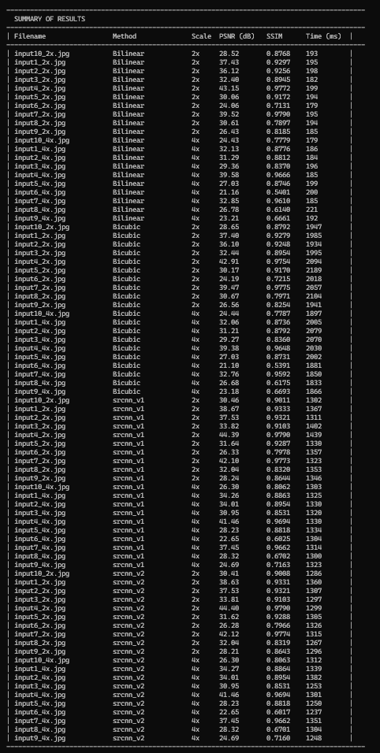

# Image Upscaler

A C++ image super-resolution playground that compares classical interpolation methods (**Bilinear**, **Bicubic**) against **learned CNN models** — the original three-layer **SRCNN** and a deeper **VDSR-style residual network** — trained in Python/PyTorch, exported to ONNX, and run in C++ via ONNX Runtime.

The project measures upscaling quality using **PSNR** and **SSIM**, and reports per-image and per-method timing so the different approaches can be compared side by side.

## Problem Statement

Enlarging a photo by classical scaling introduces pixels that don't exist in the source image. Naively stretching the image loses sharpness and detail, producing a blurry or blocky result. The goal of this project is to fill in those missing pixels using interpolation techniques and trained neural network.
Two families of approaches are compared:

- **Classical interpolation** — deterministic, per-pixel weighted averaging of neighboring pixels (**Bilinear**, **Bicubic**).
- **Learned reconstruction** — **Convolutional Neural Networks** (SRCNN, VDSR-style) trained to map low-resolution patches to high-resolution ones.

Both color (RGB) and grayscale images are supported, since a pixel is represented either as a `(R, G, B)` triple or a single intensity value.

## Overview

- **Classical interpolation** (`Bilinear`, `Bicubic`) is implemented from scratch in C++.
- **CNN models** (SRCNN and a VDSR-style net, see `CNN/models.py`) are trained in Python using PyTorch, exported to ONNX, and can be hot swapped simply by dropping new `.onnx` files into the models folder — every model found is automatically benchmarked.
- Image I/O is handled with [`stb_image`](Image%20Upscaler/includes/stb_image.h) / [`stb_image_write`](Image%20Upscaler/includes/stb_image_write.h).
- Inference uses **ONNX Runtime**, and channel conversion/resizing uses **OpenCV**.
- Both dependencies (OpenCV and ONNX Runtime) are fetched automatically by CMake — no manual installation required.

## Technologies

- **Languages:** C++, Python
- **C++ libraries:** STL, `stb_image.h`, `stb_image_write.h`, OpenCV, ONNX Runtime (`dnn`-style inference)
- **Python libraries:** NumPy, OpenCV, PyTorch
- **Compiler:** Visual C++ 2022
- **Interpreter:** Python 3.12.6
## Project Structure

```
Image Upscaler/
├── Image Upscaler.cpp        # Entry point: runs all methods and prints a results summary
├── core/
│   ├── Image.h / .cpp        # Simple RGB image container (load/save via stb_image)
│   └── Scaler.h / .cpp       # Generic resampling loop driven by an IInterpolator
├── interpolation/
│   ├── IInterpolator.h       # Interpolator interface
│   ├── Bilinear.h / .cpp     # Bilinear interpolation
│   └── Bicubic.h / .cpp      # Bicubic interpolation (Catmull-Rom kernel, a = -0.5)
├── metrics/
│   └── Metrics.h / .cpp      # PSNR and SSIM calculation
├── srcnn/
│   └── SRCNNUpscaler.h / .cpp# Loads a .onnx SRCNN model and runs inference via ONNX Runtime
└── includes/                 # stb_image / stb_image_write (public domain)

CNN/
├── models.py                  # Architectures: SRCNN (9-5-5) and VDSR-style residual net, picked by name
├── SRDataset.py               # Patch-based training dataset (augmentation + downscale/upscale pairs)
├── train_cnn.py               # Training loop (--arch srcnn|vdsr), saves the best checkpoint to models/pth/
└── export_onnx.py             # Exports trained checkpoints to models/onnx/<arch>_vN.onnx

CMakeLists.txt                 # Top-level project, defines the train_* / export_onnx targets
Image Upscaler/CMakeLists.txt  # Builds the C++ executable, fetches OpenCV + ONNX Runtime
```

## Interpolation Methods

### Bilinear interpolation

Bilinear interpolation extends 1D linear interpolation to two dimensions.Llinear interpolation is applied along the x-axis first (giving two intermediate values `R1` and `R2`). Second linear interpolation is applied along the y-axis between those two values to get the final pixel `P`:

```
R1 = f(x, y1) = ((x2 - x) / (x2 - x1)) * f(Q11) + ((x - x1) / (x2 - x1)) * f(Q21)
R2 = f(x, y2) = ((x2 - x) / (x2 - x1)) * f(Q12) + ((x - x1) / (x2 - x1)) * f(Q22)
P  = f(x, y)  = ((y2 - y) / (y2 - y1)) * R1     + ((y - y1) / (y2 - y1)) * R2
```

This uses the 4 nearest neighboring pixels (`Q11`, `Q21`, `Q12`, `Q22`) around the target point.

### Bicubic interpolation

Bicubic interpolation uses a 4×4 neighborhood (16 pixels) instead of 4, trading extra computation time for higher precision and sharper results:

```
I(x, y) = Σ(i=-1..2) Σ(j=-1..2)  I_orig(x_i, y_j) · w(x - x_i) · w(y - y_j)
```

where `w(x)` is the cubic convolution kernel:

```
w(x) = (a + 2)|x|³ - (a + 3)|x|² + 1        if |x| ≤ 1
w(x) = a|x|³ - 5a|x|² + 8a|x| - 4a          if 1 < |x| < 2
w(x) = 0                                     otherwise
```

`a` is typically `-0.5` (Catmull-Rom spline).

### Learned models (CNN)

Convolutional Neural Networks trained to learn the mapping from a low-resolution image to its high-resolution counterpart. Two architectures are available in `CNN/models.py` and selected by name (`--arch`):

| Name | Architecture | Params | Reference |
|---|---|---|---|
| `srcnn` | 3 conv layers, 9×9 → 5×5 → 5×5 kernels, 64 and 32 feature maps, no skip connection | ~57k | Dong et al., *Image Super-Resolution Using Deep Convolutional Networks*, 2014 |
| `vdsr` | 8 conv layers, 3×3 kernels, 64 feature maps, **residual learning** (the net predicts the correction added to the bicubic input). A shallower variant of the 20-layer original. | ~223k | Kim et al., *Accurate Image Super-Resolution Using Very Deep Convolutional Networks*, 2016 |

Common to both:

- Input: a single-channel (luminance) patch that has already been enlarged to the target size with bicubic interpolation; output: the reconstructed patch of the same size.
- Trained in **PyTorch** with **MSE loss** and the **Adam** optimizer. SRCNN uses a 10× smaller learning rate for its reconstruction layer, as in the paper.
- Checkpoints (`models/pth/best_<arch>.pth`) store the architecture name and configuration alongside the weights, so `export_onnx.py` can rebuild any model without extra arguments.
- After training, the model is evaluated on images that were **not** part of the training set, to check that it generalizes rather than memorizes.
- **Inference on new images happens in C++ via ONNX Runtime**, after exporting the trained checkpoint to `.onnx`.

## Requirements

- **Visual Studio 2022** with the "Desktop development with C++" workload and CMake support
- **vcpkg** (configured via `vcpkg.json` / `vcpkg-configuration.json`, used through `VCPKG_ROOT`)
- **Python 3** in `PATH` (required for the `train_cnn` and `export_onnx` CMake targets — PyTorch, OpenCV-Python, ONNX, and ONNX Runtime must be installed in that environment)
- Internet access on first configure (CMake `FetchContent` downloads prebuilt OpenCV and ONNX Runtime)

## Building & Running

This project is designed to be opened directly in **Visual Studio** as a CMake project (`File → Open → CMake...`), which will pick up `CMakePresets.json`.

1. Open the folder in Visual Studio and let it configure the CMake cache (this fetches OpenCV and ONNX Runtime on first run).
2. In the **CMake Targets View**, you'll see the project laid out as:
   - `CMakeTarget` — the C++ executable (the upscaler/benchmark itself)
   - `train_srcnn` / `train_vdsr` — trains a new model of that architecture
   - `train_cnn` — trains the architecture chosen by the `SR_ARCH` CMake cache variable (default `vdsr`)
   - `export_onnx` — exports every already-trained checkpoint in `models/pth/` to ONNX

   

3. **(Optional) Train a model:** Right-click `train_srcnn` or `train_vdsr` → **Build**. This runs `CNN/train_cnn.py`, which trains the chosen network for a fixed time budget, saves the best checkpoint to `models/pth/best_<arch>.pth`, then automatically exports it to `models/onnx/<arch>_vN.onnx`. From a terminal, the script takes more options:

   ```
   python CNN/train_cnn.py --arch srcnn --minutes 60 --scale 2 --batch-size 64 --lr 1e-4
   ```
4. **Run the benchmark:** Set `CMakeTarget` as the startup item and run it. It will:
   - Load every image in `data/originals`
   - Upscale the corresponding downscaled versions using Bilinear, Bicubic, and every `.onnx` model found in `models/onnx/`
   - Compute PSNR/SSIM against the originals and print a summary table
   - Save all upscaled images to `results/`

### Expected data layout

```
data/
├── originals/          # Ground-truth 1024x1024 images
└── downscaled/
    ├── 2x/              # Originals downscaled to 512x512
    └── 4x/              # Originals downscaled to 256x256
models/
└── onnx/                # Trained models, named <arch>_vN.onnx (srcnn_v1.onnx, vdsr_v1.onnx, ...)
```

Filenames in `downscaled/` are matched back to their originals using a shared prefix (see `generate_key` in `Image Upscaler.cpp`), so keep naming consistent, e.g. `input1_2x.jpg` ↔ `input1.jpg`.

## Dataset

- **Benchmark/test set:** 10 freely-licensed photographs sourced from [Unsplash](https://unsplash.com), used to evaluate and compare all upscaling methods.
- **CNN training set:** [BSD100](https://www.kaggle.com/datasets/asilva1691/bsd100) — 100 images, already split into training/validation subsets (80/20).

For every test image, width, height, and per-pixel values `(R, G, B)` (or a single grayscale value) are the attributes tracked and fed into the interpolation algorithms.

## Methodology

Each original image is **1024×1024**. To create a fair test set for both scale factors:

- For **2x** upscaling, originals are first downscaled to **512×512**, then upscaled back to **1024×1024**.
- For **4x** upscaling, originals are first downscaled to **256×256**, then upscaled back to **1024×1024**.

The resulting 1024×1024 images are then compared against the original 1024×1024 images using **PSNR** and **SSIM**. Note that some quality loss is inherent to the process itself, since the initial downscale already discards information before any upscaling method gets a chance to reconstruct it.

## Results

Below is a sample run comparing Bilinear, Bicubic, and two CNN checkpoints (`srcnn_v1`, `srcnn_v2`) across 10 test images at 2x and 4x.

> **Note:** the two checkpoints in this run were trained with the 8-layer residual network, which is now named `vdsr` in `CNN/models.py` (the ONNX files were renamed to `vdsr_v1.onnx` / `vdsr_v2.onnx`). They are *not* the 3-layer SRCNN; a run with the real `srcnn` architecture is still to be added.

### Per-image results



### Averages per method


**Takeaways from this run:**

- Both CNN checkpoints clearly outperform classical interpolation on **PSNR and SSIM** at both scale factors, with the largest gains visible at **2x** (~34.5 dB vs. ~32.8–32.9 dB for Bilinear/Bicubic).
- **Bilinear** is by far the fastest (~190 ms average), while **Bicubic** costs roughly 10x more time for a comparable or only slightly better result than Bilinear.
- The **CNN** models sit in between on runtime (~1.3 s average) but deliver the best quality by a clear margin, making them the best trade-off when quality matters more than raw speed.

*(Numbers above come from a specific run and will vary depending on the dataset, training duration, and hardware.)*

## Metrics

### PSNR (Peak Signal-to-Noise Ratio)

Measures the ratio between the maximum possible signal power and the power of the noise (error) affecting its fidelity. Higher is better.

```
PSNR = 10 · log10( MAX_I² / MSE )
```

where `MAX_I` is the maximum possible pixel value (255 for our 8-bit images) and `MSE` is the mean squared error between the original and reconstructed image:

```
MSE = (1 / (m·n)) · Σ Σ [I_orig(i, j) − I_new(i, j)]²
```

Interpretation for 8-bit images:

| PSNR | Quality |
|---|---|
| 48.131 dB | Maximum achievable quality |
| > 35 dB | Very good quality |
| 25–35 dB | Good quality |
| < 25 dB | Poor quality |

### SSIM (Structural Similarity Index)

Measures perceived similarity between two images, accounting for changes in structure, luminance, and contrast. Closer to 1.0 is better.

```
SSIM(x, y) = ((2·μx·μy + C1) · (2·σxy + C2)) / ((μx² + μy² + C1) · (σx² + σy² + C2))
```

where `μx`, `μy` are the mean pixel values of images `x` and `y`, `σx²`, `σy²` are their variances, `σxy` is the covariance between them, and `C1`, `C2` are small stabilizing constants that prevent division by (near) zero.

Interpretation:

| SSIM | Similarity |
|---|---|
| 1 | Perfect similarity |
| 0.8 – 1 | Very good similarity |
| 0.6 – 0.8 | Good similarity |
| < 0.6 | Low similarity |
| 0 | No similarity |
| -1 | Completely different images |

### Timing

Wall-clock execution time is also measured and compared for every method, since interpolation quality generally comes at the cost of extra computation.

| Metric | Meaning | Better when... |
|---|---|---|
| PSNR (dB) | Ratio between max possible pixel value and reconstruction error (MSE-based) | Higher |
| SSIM | Structural similarity between two images (luminance, contrast, structure) | Closer to 1.0 |
| Time (ms) | Wall-clock time to upscale a single image | Lower |

